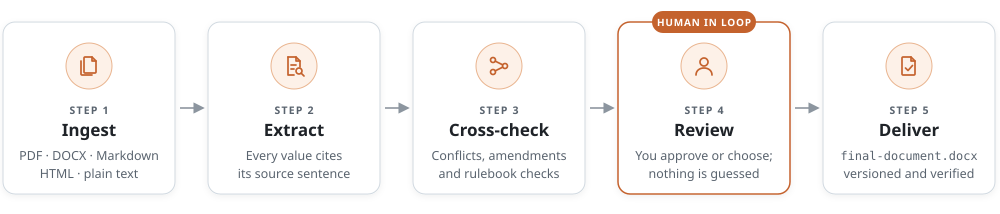
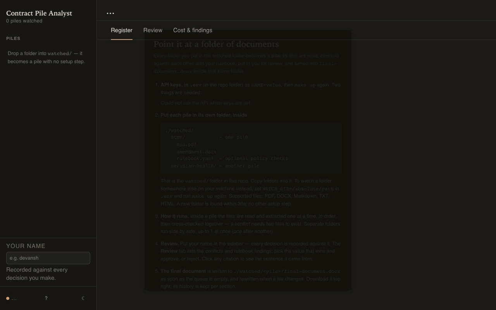
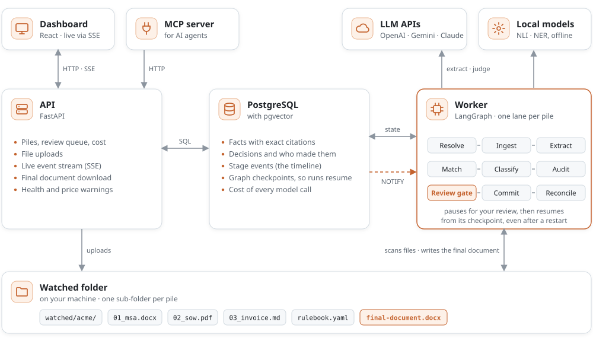

<div align="center">

<picture>
  <source media="(prefers-color-scheme: dark)" srcset="docs/media/logo-dark.svg">
  
</picture>

<h3>Reads. Reconciles. Reports.</h3>

<p>Turns a folder of contracts into one cited, verified final document,<br>and asks you only where the sources disagree.</p>

<p>
  <a href="https://github.com/NigamDevansh/documents-analyst/actions/workflows/ci.yml"></a>      
</p>

<p>
  <a href="#quick-start"><b>Quick start</b></a> ·
  <a href="#architecture"><b>Architecture</b></a> ·
  <a href="docs/"><b>Docs</b></a>
</p>

</div>

<br>

<picture>
  <source media="(prefers-color-scheme: dark)" srcset="docs/media/pipeline-dark.svg">
  
</picture>

## Demo

<p align="center">
  
</p>
<p align="center"><sub>Open a pile · trace a value to its source sentence · upload an amendment · review · get <code>final-document.docx</code> v2 · see what it cost</sub></p>

## Quick start

**Prerequisites**

| Requirement | Notes |
|---|---|
| **Docker** | Docker Desktop, or Docker Engine with Compose v2. About 10 GB of free disk. |
| **make, git** | Preinstalled on macOS and Linux. |
| **An API key** | `OPENAI_API_KEY` or `GEMINI_API_KEY` covers everything. With `ANTHROPIC_API_KEY`, add one of those too: Claude has no embedding model. |

**Run**

```bash
git clone https://github.com/NigamDevansh/documents-analyst.git
cd documents-analyst
cp .env.example .env    # then add your API key
make up                 # first build takes 5–10 minutes
```

Open **http://localhost:8000**, then:

1. **Add documents.** Copy a folder into `watched/`, or click **Upload files** on a pile.
2. **Review.** Enter your name, open **Review**, approve or choose.
3. **Collect.** `final-document.docx` is written into the pile's folder and can be downloaded from the dashboard.

**Good to know**

- `make down` stops everything. Your data is kept.
- Watch a different folder by setting `WATCH_DIR=/absolute/path` in `.env`, then `make up`.
- Drop a `rulebook.yaml` into a pile to check its terms against your own rules.
- `make test` runs the full suite. No API keys needed.

## Architecture

<picture>
  <source media="(prefers-color-scheme: dark)" srcset="docs/media/architecture-dark.svg">
  
</picture>

<p align="center"><sub>Deeper dives: <a href="docs/BACKEND_INTERNALS.md">Backend</a> · <a href="docs/WORKER_RUNTIME.md">Worker runtime</a> · <a href="docs/CORE_INTERNALS.md">Core</a> · <a href="docs/TESTING.md">Testing</a></sub></p>
