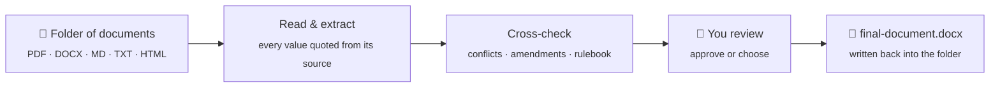
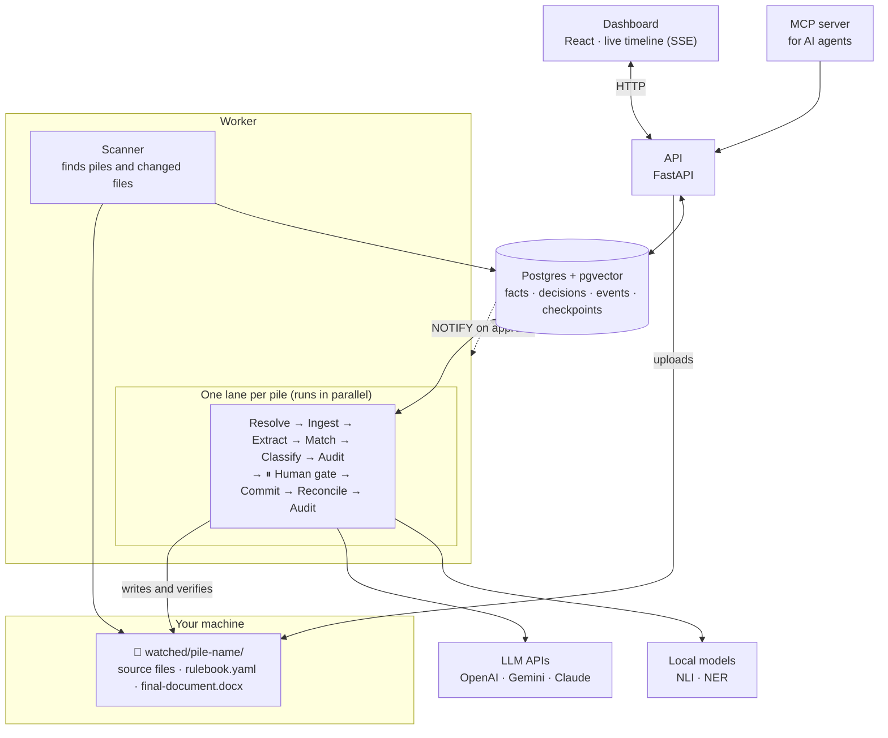

<h1 align="center">Document Analyst</h1>

<p align="center"><b>Reads. Reconciles. Reports.</b></p>



<p align="center">
  
</p>

## Run it locally

**Prerequisites**

- Docker Desktop (or Docker Engine with Compose v2), with ~10 GB free disk
- `make` and `git` (built in on macOS and Linux)
- An API key, either:
  - `OPENAI_API_KEY` or `GEMINI_API_KEY`: one key covers everything
  - `ANTHROPIC_API_KEY` plus an OpenAI or Gemini key. Claude has no embedding model.

**Steps**

1. Clone the repo
   ```bash
   git clone https://github.com/NigamDevansh/documents-analyst.git && cd documents-analyst
   ```
2. Add your key
   ```bash
   cp .env.example .env    # then set e.g. OPENAI_API_KEY=sk-...
   ```
3. Start everything. The first build takes 5–10 minutes.
   ```bash
   make up
   ```
4. Open **http://localhost:8000**
5. Add documents. Either way works:
   - copy a folder into `watched/`, so `watched/<name>/` becomes a pile;
   - or click **Upload files** on an open pile.
6. Review: enter your name, open **Review**, approve or choose.
7. Collect `final-document.docx` from the pile's folder, or download it from the dashboard.

**Good to know**

- Stop with `make down`. Your data is kept.
- Watch another folder: set `WATCH_DIR=/absolute/path` in `.env` and run `make up` again.
- Add `rulebook.yaml` to a pile to check its terms against your own rules.
- Run the tests (no keys needed) with `make test`.

## Architecture


