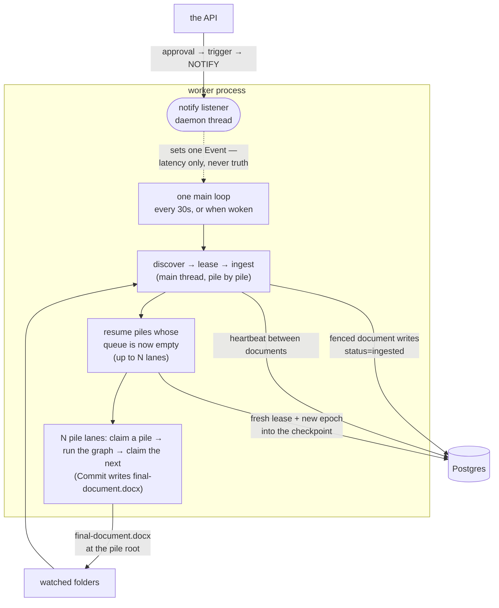

# How the worker actually runs

The "zeroth flow" — what is alive, what wakes it, and how a file on disk
becomes a row the graph can pick up. Everything downstream of that is covered
in [`BACKEND_INTERNALS.md`](BACKEND_INTERNALS.md); this is the part underneath it.

---

## 1. The short answer

**This is one process with one timer-driven loop, a small pool of per-pile
thread lanes that the loop fans out to for graph work, plus one daemon thread
that only makes the loop wake sooner.** There is no cron, message broker,
filesystem listener or background heartbeat thread. The `Built` column below
records which phase each part arrived in.

| Thread | What it does | Lifetime | Built |
|---|---|---|---|
| **main loop** | Every 30s: discover folders, acquire each pile lease, scan and ingest it — one pile after another | whole process | **Phase 3** |
| **pile lanes** | Up to `pile_concurrency` threads (named `pile_0`, `pile_1`, …); each claims a pile, runs or resumes its graph, claims the next | one pass's drain, then joined | **Per-pile threading** — see §1a |
| **graph runner** | Claims ingested, graph-ready documents and runs the graph | inside a lane, after discovery | **Phase 4A, a function a lane calls** |
| **resume sweep** | Resumes piles whose review queue is now empty | inside the lanes, before the runner | **Phase 5, a function a lane calls** |
| **notify listener** | Holds a Postgres `LISTEN` connection and sets one `threading.Event` | daemon, whole process | **Phase 5** |
| **watchdog** | Filesystem events → taps the scanner on the shoulder | daemon, optional | Not built, not declared — see §5 |
| **heartbeat** | Renews the lease so nobody steals the pile | while a lease is held | **Phase 3, but not a thread** |

**Phase 3 deliberately built one loop, not four threads, and the loop is still
the spine.** Each tick discovers folders and then drains whatever discovery made
ready, so a document found in a pass is extracted in the same pass rather than
thirty seconds later. Discovery — scan, hash, parse — stays on the main loop
thread, sequential per pile. Only the drain fans out: separate piles are
independent (§9), so folder 2 should not wait for folder 1's extraction, and the
coordination that makes it safe already existed — the claim plus the lease that
coordinate *processes* coordinate threads in one process just as well. §1a has
the detail.

**The one thread Phase 5 did add does as little as possible.** It sets an event.
It does not carry a pile id into the loop, does not queue work, and nothing
downstream branches on which notification arrived. A listener that *delivered*
work would make a missed notification a lost pile; this one makes it a slower
one.

One ordering detail that is easy to get backwards: the event is cleared **before**
the pass, never between the pass and the wait. An approval that lands while a
pass is running arrives too late for that pass, so the flag has to survive into
the wait and start the next one immediately. Clearing afterwards drops exactly
that notification — and it is the common one, since a pass is when the worker is
busy enough to be worth notifying.

A lane stops early on one condition, and it is the loop refusing to spin. A run
that finished without retiring a single document leaves the pile exactly as
claimable as it found it — which is what a provider outage looks like from here,
and the only useful response is to stop that lane until the next tick. A pile
that pauses at the human gate is *not* such a stop: it is marked
`awaiting_review`, which the normal claim query excludes even though it still
holds `ingested` documents, so the lane goes straight on to claim the next pile
in the same pass (it used to break here and leave the rest for the next tick).
Only the explicit approval path may resume a paused pile's checkpoint. `limit`
remains a per-lane circuit breaker, not a batch size: a pile that ends a run
still holding ingested documents would otherwise be re-claimed for ever inside
one tick, and the lane would never get back to the stop flag.

`notify` and `watchdog` only make the scanner wake *sooner*. The scan
reconciles rather than consuming events, so their absence costs latency — about
1 second versus up to 30 — and nothing else. Until Phase 5 the channel had no
publisher at all, which is why the listener waited for the API: a consumer for a
silent channel is not a feature.

The **heartbeat is not a thread either**. Discovery renews immediately **before
each document is read**; the graph renews immediately before an embedding batch
and each structured LLM request. Every bounded unit of work therefore starts
with a full `LEASE_TTL_S`. On a timer, a renewal that happened 85 seconds ago
can sit in front of a two-minute parse, and the write afterwards is then refused
by its own fence — for ever, on every pass, with one pathological file stalling
the whole pile behind it.

A background thread would renew the lease *during* that parse instead, which
looks like the obvious fix and is worse: it extends authority the worker is
making no progress under, which is exactly what fencing exists to revoke.

The remaining bound is honest and stated: **one bounded read, embedding batch,
or model request that takes longer than `LEASE_TTL_S` cannot commit.** Raise the
TTL if a pile holds work that slow.

```python
epoch = lease.acquire(conn, pile_id, me, ttl_s)      # one statement
ingest_pile(engine, fence=Fence(pile_id, epoch), …)  # renews before each read
lease.release(conn, pile_id, epoch)                  # fenced; a late release is a no-op
```

**Reading and writing are separate steps** (§7a rule 2). `read_document` hashes
and parses one file with no database connection in scope; `_apply` decides and
writes with no filesystem access, and only `_apply` runs inside a transaction.
So hashing a 200MB PDF holds no row lock — checked directly by
`test_hashing_and_parsing_happen_outside_the_transaction`, which asserts that no
transaction is open at the moment a file is read.

Every mutating write carries an atomic `EXISTS` predicate for its pile ID, lease
epoch, **and unexpired TTL**. A worker that lost or outlived its lease mid-pile
writes nothing more — checked by
`test_a_takeover_mid_ingest_stops_the_old_worker_writing`,
`test_an_expired_worker_cannot_resurrect_its_own_lease`, and by a test that
reads the repository source and fails on any write missing the fence.

---

## 1a. Pile lanes: separate piles in parallel, files in one pile in order

**One subfolder of the watched folder is one pile, and separate piles run in
parallel, one thread each.** `pile_concurrency` in `config/runtime.yaml`
(default 3, range 1–16) is how many. With folder 1 (5 files) and folder 2
(10 files) both waiting, folder 2 does not wait for folder 1's extraction.

```
main loop thread     discover: scan · hash · parse   pile A, then B, then C, then D
                                    │
                     drain_resumes ─┼─ up to N lanes, one reviewed pile each   (_resume_one)
                     drain_runs    ─┘  N = 3 lanes in a ThreadPoolExecutor("pile")
                                         lane 1: claim A → run A (pauses at gate) → claim D → run D → nothing → return
                                         lane 2: claim B → run B → nothing → return
                                         lane 3: claim C → run C → nothing → return
                     lanes joined; wait for the event or the timer
```

**The claim is what keeps lanes apart, and it is the same claim that keeps
containers apart.** Each lane loops: `runner.run_pile` claims a pile with
`queue.claim_and_lease` — `FOR UPDATE SKIP LOCKED` plus a fenced lease, in one
statement — runs it, and claims the next. A row one lane has locked is skipped
by the others, so two lanes, two threads or two worker containers never take
the same pile; when nothing claimable is left, the lane returns. Lane owner ids
are `<worker_id>/lane-N` when there is more than one lane (the plain worker id
when there is one), so `lease_owner_id` says which thread holds a pile. That is
for reading only: fencing is by lease epoch, never by owner, so lanes sharing a
prefix cannot vouch for each other's writes.

`drain_resumes` resumes reviewed piles in parallel too, under the same lane cap,
one `_resume_one` per resumable pile. Both drains go through `_in_parallel`: a
lane or pile that raises is logged and costs only itself — the other piles carry
on, which is the same rule the sequential loop applied to one pile in a pass.

**Discovery is not parallel.** Scanning, hashing and parsing stay on the main
loop thread, one pile after another, each under its own lease. The slow,
waiting part of a pile — the LLM calls — is in the graph, and that is the part
the lanes overlap.

### What the lanes share, and how each part is made safe

| Shared across lanes | Why it is safe |
|---|---|
| The LangGraph `PostgresSaver` checkpointer | Locks per cursor already, so it is thread-safe as it stands; checkpoints are keyed by pile id |
| The LLM client | Stateless per call; nothing from one request survives into the next |
| `OpenAIEmbeddings` | An HTTP client whose only state, `last_usage`, is now **thread-local** — each pile's cost report gets its own embedding usage, not a neighbour's |
| The local NLI (DeBERTa) and NER (GLiNER) models | Wrapped by `models.shared_across_threads` in `_Serialized`, a per-model lock. Hugging Face fast tokenizers are not thread-safe — two threads in one at once raise "Already borrowed" — so these calls take turns. They take milliseconds next to an LLM call's seconds, and one set of weights serves every lane instead of a copy per thread |
| Postgres rows | Every write is epoch-and-TTL fenced to its pile's lease (§1) |

**LLM calls run concurrently**, which is the point — and the cost: raising
`pile_concurrency` multiplies the request rate against your provider. Raise it
only as far as the provider's rate limit allows. `pile_concurrency: 1` restores
strictly one pile after another, with the drain running on the main loop
thread exactly as it did before lanes existed.

### Inside one pile, files go strictly one at a time

Lanes parallelise *piles*, never files. A pile's graph is

```
Resolve → Ingest → Extract → Match → Classify → Audit → HumanGate → Commit → Reconcile → Audit (pass 2)
```

and Ingest and Extract each loop over the pile's documents **one at a time, in
discovery order** (`ORDER BY created_at`). File 1 is fully extracted before file
2 starts; no two files of one pile are ever in flight at once. Only after every
file is extracted do the cross-file stages run, once, over the whole pile:
matching facts across files, conflicts and amendments, the rulebook audit, human
review, and the final-document write.

It is **not** "finish file 1, including its final document, before file 2". A
conflict needs two files to exist, so the document is written once per review
round, not once per file. A file added later goes through the same steps, and
only the sections it affects change.

**The final document is checked on every discovery pass too.** Resolve only runs inside
a run, and an idle pile is never claimed, so a `final-document.docx` deleted or edited
while nothing else changed would otherwise stay broken. `discover` therefore calls
`check_final_document` for each pile it holds the lease on: a `stat`, compared with the
`(mtime, size, recorded sha)` it last verified, and a full read-back (`deliverable.verify`)
only when one of those moved. A mismatch is repaired with the same
`resolve.repair_from_record` Resolve uses — written from the record, version unchanged,
a `stage.resolve.done {repaired: true}` event. It is skipped once shutdown is requested,
and a failure to repair is logged without marking the pile `error`.

---

## 2. The Phase 5 boundary

The scanner and the graph runner are separated through Postgres, and both now
exist. Discovery stores a document as `ingested` and releases its lease; the
runner claims a pile with `ingested` originals, takes its lease in the same
statement, and drives the graph over the whole batch. A document that has been
extracted moves to `extracted` and leaves the queue, which is what stops the
same pile being run again on the next tick.

When an approval arrives, `resume_after_approval` takes a fresh lease and
updates the durable graph state with the new `lease_epoch` before resuming the
interrupt. Checkpointed business-control state is preserved; the operational
fencing token must belong to the worker that is running now.

### 2.1 What actually makes a paused pile resumable

**An empty review queue — not an approval.** The gate re-interrupts while
anything is still `pending` (`human_gate.py`), so resuming on each click would
take a lease, start a run, pause again and write two events, per click. And a
reviewer who *rejects* every item has still finished reviewing: that run must
reach Reconcile and end, or the pile waits in `awaiting_review` for ever because
nobody agreed to anything.

```sql
status = 'awaiting_review'
AND lease expired
AND NOT EXISTS (pending decision for this pile)
```

A sweep, not a handler on the notification. The `NOTIFY` only makes it happen
sooner; a pile whose notification was lost is picked up on the next tick,
because this asks the database rather than remembering what it was told.

### 2.2 A resumed run that raises must not strand the pile

Found live in Phase 5, and the cause was mundane: a pile's `rulebook_path` had
been recorded by a worker inside a container and pointed at a path the host
process could not read.

A node that raises leaves `status = 'running'` describing a run that is not
running, and for a reviewed pile that is a one-way door — the normal claim needs
`ingested` documents, which it no longer has, and the resume sweep needs
`awaiting_review`. The checkpoint sits at the gate with nothing able to reach it.
No error anywhere, and no way back.

`resume_after_approval` now restores `awaiting_review` inside the lease it still
holds, before letting the error out. Restored rather than marked `error` because
`awaiting_review` is the truth: the queue is empty and the checkpoint is at the
gate. The next tick then retries once the cause is fixed, instead of waiting for
somebody to notice.

The retry cost nothing it had already paid for. LangGraph resumed **after**
Commit and Reconcile and re-ran only the node that failed — the first live
demonstration of the §7a rule that a successor re-runs at most one node.

```
run 1 (epoch 7)  resumed → gate.clear → commit.applied → reconcile.done → raised
run 2 (epoch 9)  resumed → audit(pass 2) → finished
```

---

## 3. Scanner and runner are decoupled through Postgres

```
scanner                          Postgres                  graph runner
────────────                     ────────                  ─────────────────
walks folders
hashes files
INSERT documents          →   status='ingested'
                                                        claims a pile AND
                          ←   UPDATE … FROM        ←     leases it, one
                                (SELECT … FOR UPDATE      statement
                                 SKIP LOCKED)
                                                        runs the graph
                              status='extracted'  ←     retires the batch
NOTIFY 'work' (Phase 5)   →   ─────────────────────→   wakes sooner
```

They do not call each other — the interface is a table. The scanner does not
know the runner exists, and the runner does not know where documents came from.
That has three payoffs:

1. **Either can crash without the other noticing.** Scanner dies → the runner
   keeps processing what's already queued. Runner dies → the scanner keeps
   filling the queue for whoever restarts.
2. **Multiple workers need no coordination.** Two scanners inserting the same
   file both hit `INSERT … ON CONFLICT (pile_id, sha256) DO NOTHING`, and
   exactly one row survives. No leader election, no locking between them.
3. **You can run them as separate processes later** with zero code change,
   because the interface is already a table rather than a function call.

---

## 4. What "scanning" actually is

No magic. `os.scandir()`, recursively, and `stat()` on each entry.

```
for each pile:
    listing = walk(pile.watch_path)                 # entries + did we see everything?
    known   = load documents.paths for this pile    # one query, whole map
    for entry in listing.entries:
        if ignored_name(entry):        continue     # ~$doc.docx, .part, .tmp, dotfiles
        if ours(entry):                continue     # final-document.docx at the pile ROOT only
        if mtime_age(entry) < settle:  continue     # one stat; safe across restart
        if unchanged(entry, known):    continue     # path+size+mtime+inode all match
        heartbeat()                                 # a full TTL for this one read
        read = hash + parse                         # NO transaction open here
        re-stat; if identity changed: retry next pass
        with transaction: decide and write          # new / alias / version / quarantine
    if listing.complete:                            # ← and only then
        mark documents whose paths all vanished as removed
```

The whole path map for a pile is loaded once per scan, so the inner loop is
memory comparisons, not queries.

**The scanner never reads the system's own output.** The final document is
written into the pile's folder, so `scan_pile(..., skip_root_names=...)` skips
exactly `deliverable_filename` at the pile **root**. Only there: a file with the
same name in a subfolder was put there by a person and is read like any other
source. The write's temp file is a dotfile, already ignored.

**`listing.complete` is load-bearing.** An empty list is two different facts
wearing the same clothes: "this folder holds no documents" and "this folder
could not be read". Reconciliation reads absence as deletion, so conflating them
turns one `chmod`, one unmounted share or one folder renamed for two seconds
into every document in the pile being marked `removed` — silently, with the log
cheerfully reporting the count. A pile that could not be listed therefore skips
removal detection entirely and says so. A file that genuinely vanished between
the listing and its `stat` is the opposite case and must stay reportable as
gone, so it does *not* taint the listing.

The same distinction protects version matching: with an incomplete listing, an
absent path is unknown rather than gone. A same-named visible file can replace
only a candidate already known solely at that same path; a possible moved
version waits for a complete scan rather than superseding a contract hidden in
an unreadable folder.

**Two speeds.** Boot always does a deep scan (hash everything) because startup
is exactly when we're most likely to have missed something. Timer scans are
shallow — skip the hash if path, size, mtime and inode are unchanged. Every
20th tick is deep again, which bounds how long an mtime-preserving copy can
hide (~10 minutes, stated in the README).

**Settling is judged from the age of the mtime, not from two probes.** The
implementation asks `now - mtime >= SETTLE_SECONDS`, so a worker that crashes
mid-copy does not need a remembered previous probe before it can safely skip the
half-written file. The clock does not forget. The gap it leaves — a writer that
stalls for longer than the window — is bounded by the deep re-hash.

---

## 5. What wakes the scanner

**The timer, and one `threading.Event`.** After every pass the main loop waits
`SCAN_INTERVAL_S` (30 seconds by default) *or* until the event is set, then
reconciles again. The first pass and every `SCAN_DEEP_EVERY`th pass are deep
scans; all other passes avoid re-hashing an unchanged file.

Phase 5 added the event and one publisher for it. Two things set it: a trigger
on `pending_decisions` when a decision leaves `pending`, and the upload route
after it writes a file. Both mean the same thing — *something changed, look
sooner* — and neither is a source of truth, so a missed notification costs
latency and not correctness.

`watchdog` was never built, and the reason is the same demotion taken to its
conclusion: it would only make the scanner wake earlier than the 30-second
timer, which is a smaller improvement than the notify channel already gives on
the paths that matter. The dependency is no longer declared either — it sat in
`backend/pyproject.toml` for a while, shipping a filesystem-event library into
every image with no code that could fire it. The case for adding it back is a
demo where dropping a file in Finder should light up in a second.

That demotion is not theoretical. On your machine specifically: Docker
Desktop's **default gRPC-FUSE** file sharing has unreliable native file
watching — the documented advice is to enable polling rather than trust events —
while VirtioFS works properly. So whether events reach the container at all
depends on a Docker Desktop setting a stranger may have set differently.

With this design, that setting only changes latency: ~1 second with working
events, up to 30 seconds without. Nothing is ever missed either way.

---

## 6. The lease, and why it is released at the human gate

The lease means **a pile has exactly one holder at a time** — one worker, and
within a worker one lane (§1a). A worker may run several *different* piles at
once; it never runs one pile twice. The lease is held for the duration of
*active work*, not the duration of a run.

This matters at `HumanGate`. When the graph hits the interrupt, the run might
wait hours for a person. If the worker kept the lease that whole time, no new
documents could be ingested into that pile and no other worker could help.

So:

```
graph returns "interrupted"  →  release the lease  →  the lane claims the next pile
```

Later, when the human approves in the UI:

```
API writes the decision  →  NOTIFY  →  a worker wakes
                         →  re-acquires the lease
                         →  resumes the graph from its checkpoint
```

The checkpoint is what makes this safe: the run's position is a row in the
database, not state in the process that paused it. **A different worker on a
different machine can pick it up.**

---

## 7. Startup and shutdown

**Startup, in order:**

1. Load and validate config (fail loudly on a bad value, not on first use)
2. Connect to Postgres, wait for migrations
3. Report model-cache availability
4. Open the graph environment once — checkpointer, models, LLM client — with
   the two local models wrapped so every pile lane can share them (§1a)
5. Install the SIGTERM/SIGINT handler
6. Start the notify listener (Phase 5), which wakes the loop once on connect
7. Start the timer loop — its first pass is always a **deep** scan

**Shutdown on SIGTERM:** set a stop flag. The scanner stops before acquiring
the next pile and the ingester checks it before each document and immediately
after hashing/parsing, and every pile lane checks it before claiming or
resuming another pile. Each releases its live lease in its `finally` block and
the process exits once the lanes have returned. A single filesystem operation already in progress is allowed to
return first; we do not start another one.

The listener is a daemon thread holding one idle connection and no state worth
draining, so shutdown does not wait for it. If Docker must kill a worker during
a single pathological parse, the TTL remains the fallback; all writes are
epoch-and-TTL fenced, so the next worker can safely take the pile.

---

## 7a. What survives when a worker freezes mid-run

A lease is not a transaction. When it expires, Postgres undoes nothing —
committed data stays committed. So if worker A finished Ingest, Extract and
Match and then froze during Classify:

| | Outcome |
|---|---|
| Documents, chunks, facts already written by A | **Kept** |
| The checkpoint saying "Match completed" | **Kept** |
| Worker B's starting point | **Classify** — the next node, not the beginning |
| The half-finished Classify work | Redone from the start by B |
| Anything A writes *after* waking up | **Rejected** — stale epoch |

Nothing is lost and nothing already paid for is repeated. B re-runs at most one
node.

### The three rules that make that true

**1. Every node's writes are idempotent.** Upsert on a natural key, never a
blind insert. A half-finished node will be run again, and it must not duplicate
what it already wrote.

**2. Transactions wrap writes, not slow work.** A node does its LLM calls and
model inference *outside* any transaction, then opens a short one to write its
results. Holding a transaction open across a five-minute extraction would keep
row locks the whole time and block the takeover it was supposed to enable.

Phase 3 obeys this by splitting the ingest step in two — `read_document` (slow,
no connection) and `_apply` (fast, no filesystem). The first version of it did
not: it claimed one-transaction-per-document as compliance while still hashing
and parsing inside that transaction, which is the same violation at a smaller
granularity. A test now asserts the property rather than the granularity.

**3. A node's data and its checkpoint commit together.** "This node finished"
and "here is what it produced" are one atomic write, so a resume can never skip
past a node whose output did not land.

### One setting, not code

If a worker freezes *inside* a transaction, Postgres holds that transaction —
and its locks — open, and the new worker waits on them. That is a database
concern, so it is fixed in the database:

```
idle_in_transaction_session_timeout = 60s
```

The frozen session is terminated, its transaction rolls back, its locks release.
With rule 2 keeping transactions short, the window where this can bite is small.
`Commit` is the one node that does file I/O inside its transaction — it writes
`final-document.docx` before committing, so a crash rolls the record back rather
than leaving a record of a file that was never written. That is a local
python-docx save of a few sections, renewed on the lease just before it, not a
network call.

---

## 8. Running more than one worker

```bash
docker compose up --scale worker=3
```

No configuration is needed. Each worker runs its own `pile_concurrency` lanes,
so three workers at the default can have up to nine piles in flight — and nine
piles' worth of concurrent LLM requests. Each worker:

- scans independently — duplicate inserts collapse on the unique constraint
- acquires a per-pile lease before it ingests, so two workers skip a live pile
- holds that lease with its own epoch
- claims graph work with `FOR UPDATE SKIP LOCKED` (4A) — the same claim that
  keeps its own lanes apart, so a lane in one container and a lane in another
  are no different from two lanes in one
- reads the same resumable-pile query, and loses the race for one harmlessly:
  `resume_after_approval` takes the lease itself, so two workers reading the
  same pile id is settled by the lease rather than by the query (5)
- writes a pile's final document only under that pile's lease, fenced in the
  same transaction that records it, so two workers can never both write it

The normal graph claim excludes `awaiting_review`. A reviewed pile is reached by
the resume sweep instead, so the timer cannot start a fresh extraction run for a
pile whose checkpoint is waiting at the gate.

If one is paused mid-run (a container throttled, a laptop sleeping) its lease
expires, another takes over, and the epoch increments. When the paused one wakes
and tries to write, the database rejects it because its epoch is stale. That is
the fencing mechanism, and this is the scenario it exists for.

---

## 9. Piles are fully independent

Confirming what you asked: **each pile has its own deliverable.** They share
nothing, and piles are never compared with each other. Each subfolder of the
watched folder is one pile with its own run, review queue, history and
`final-document.docx`; you never pass individual files in, and you never move
the repo — point `WATCH_DIR` in `.env` at the folder instead
([`BUILD_AND_RUNTIME.md`](BUILD_AND_RUNTIME.md)). Independence is also what
makes the lanes of §1a safe: two piles running side by side have no row, file or
decision in common.

| Scope | What is per-pile |
|---|---|
| Watched folder | `piles.watch_path` |
| The final document | `<watch_path>/final-document.docx`, recorded in `piles.deliverable_*` |
| Rulebook | `piles.rulebook_path` |
| Lease | `piles.lease_owner_id / lease_epoch` |
| Status | idle · scanning · running · awaiting_review · error |

The **Pile Navigator** in the left sidebar lists them with a live status dot, and
selecting one switches the whole workspace — register, source pane, review queue
and cost widget all scope to that pile. The selection lives in the URL hash
(`#pile=<id>&tab=review`), not a router, so a specific pile — and tab — is a
shareable link, and editing the hash switches it.

**One level down:** a pile can contain several *agreements* (our
`conflict_pile` fixture has two vendors). One pile still means one final
document — inside it, sections are grouped under one heading per agreement, because
`claim_slots` are keyed by `(agreement_id, field_key)`. So "Acme Corporation ×
Beta Logistics" and "Cobalt Manufacturing × Sparrow Industrial" appear as
separate sections of the same register, and a conflict can never be raised
between two different agreements.

---

## 10. The whole thing in one picture


